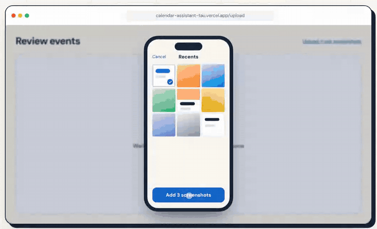

# Booked and Busy

**Screenshot it. Schedule it.** Booked and Busy turns screenshots from GroupMe, Flare, texts, emails, and flyers into calendar events. Review each one next to your Google Calendar, then add it in one click. By Bri London.



## Demo recording

The homepage demo (`app/components/review-demo.js`) is an animated recreation of the review screen using sample events; it never calls the API. To re-record `public/demo/review-demo.gif` and `.mp4` after changing it, start the app and run `node scripts/record-demo-gif.mjs http://localhost:3000` (needs Playwright with Chromium and ffmpeg).

## Local development

```sh
pnpm install
pnpm dev
```

Open http://localhost:3000. You can also use npm instead of pnpm.

## Production

```sh
pnpm build
pnpm start
```

To deploy later, import this repository into Vercel and use its Next.js defaults.

## Enable sign-up and login

1. Enable the Google provider and new user sign-ups in [Supabase Authentication](https://supabase.com/dashboard/projects). In Google Cloud, authorize the callback shown on the Supabase Google provider screen.
2. Under **Authentication → URL Configuration** in Supabase, set **Site URL** to the production website origin. Add `http://127.0.0.1:3000/auth/callback` and the production website origin followed by `/auth/callback` to **Redirect URLs**. If you use `localhost` instead of `127.0.0.1`, also allow `http://localhost:3000/auth/callback`.
3. Set `SUPABASE_URL` and `SUPABASE_PUBLISHABLE_KEY` in `.env.local` and in the Vercel project. Use the project URL and publishable key from Supabase. Set `SITE_URL` in Vercel to the production website origin, then redeploy. Restart the local dev server after changing `.env.local`.
4. Test **Continue with Google** on the local site and then on the production domain. If your Google OAuth app is in Testing, use an account permitted by that app.

## Payments (Stripe)

Every account gets 3 free screenshot extractions. After that, a subscription is needed: $2.99/month, with a 7-day free trial the first time. Billing stays off, and everything stays free, until all four variables below are set in Vercel.

1. **Database.** Run `supabase/billing.sql` in the Supabase SQL Editor. Copy a **secret key** from Supabase → Project Settings → API Keys and save it as `SUPABASE_SECRET_KEY` in Vercel. It is used only on the server and must never be exposed to the browser.
2. **Product and price.** In Stripe → Product catalog, create a product "Booked and Busy" with a recurring price of $2.99 per month. Save the price ID (`price_...`) as `STRIPE_PRICE_ID`.
3. **API key.** In Stripe → Developers → API keys, save the secret key (`sk_test_...` while testing) as `STRIPE_SECRET_KEY`.
4. **Webhook.** In Stripe → Developers → Webhooks, add an endpoint for `SITE_URL` + `/api/stripe/webhook` with the events `checkout.session.completed`, `customer.subscription.created`, `customer.subscription.updated` and `customer.subscription.deleted`. Save its signing secret (`whsec_...`) as `STRIPE_WEBHOOK_SECRET`.
5. **Customer portal.** In Stripe → Settings → Billing → Customer portal, turn it on and allow customers to update payment methods, view invoices and cancel subscriptions.
6. Redeploy. Test with card `4242 4242 4242 4242`, any future date and any CVC.

To go live, repeat steps 2–4 in Stripe's live mode and replace the three Stripe values in Vercel.

To give an account unlimited free use (for example your own), add `FREE_ACCOUNT_EMAILS` in Vercel with its sign-in email. Separate several emails with commas. Only verified emails count, and those accounts never see the paywall.

## Google Calendar connection

Enable the Google Calendar API in the Google Cloud project used for sign-in. While the OAuth app is in Testing, add your Google account under Audience → Test users. Under Data Access, configure `https://www.googleapis.com/auth/calendar.events.owned` for viewing and eventually adding events on owned calendars.

From `/account`, choose **Connect Google Calendar** and grant Calendar access. The account page shows the selected day from the signed-in Google account’s primary calendar, using the browser’s time zone. Choose the same Google account when reconnecting.

### Save connections across logins

1. Run `supabase/calendar-connection.sql` in the Supabase SQL Editor. It creates an encrypted-token table with per-user Row Level Security. Enable the Data API under Supabase Integrations → Data API so the server can read this table through the signed-in user's session. Leave automatic exposure of new tables disabled.
2. Add `GOOGLE_OAUTH_CLIENT_ID` and `GOOGLE_OAUTH_CLIENT_SECRET` to Vercel. Use the same web OAuth client credentials configured in the Supabase Google provider.
3. Generate a 32-byte encryption key with `node -e "console.log(require('node:crypto').randomBytes(32).toString('hex'))"`. Save the output as `GOOGLE_TOKEN_ENCRYPTION_KEY` in Vercel. Keep this stable across deployments. Changing it makes saved tokens unreadable and requires users to reconnect. Use the same variables in `.env.local` for local testing.
4. Redeploy and connect Google Calendar once more to grant offline access. New connections are encrypted using AES-256-GCM, bound to the user's ID, and stored in the private per-user table. Calendar access tokens are refreshed on demand. Signing out preserves the saved connection. Disconnect removes it from the app.

Until all three new environment variables are set, the existing short-lived connection remains available. After enabling saved connections, users must connect once to save a refresh token. Google can still revoke refresh tokens. OAuth applications in Testing generally have refresh tokens that expire after seven days for Calendar scopes. Production publishing and any required Google verification are separate setup steps. The screenshot review/add/reject workflow is still pending.
